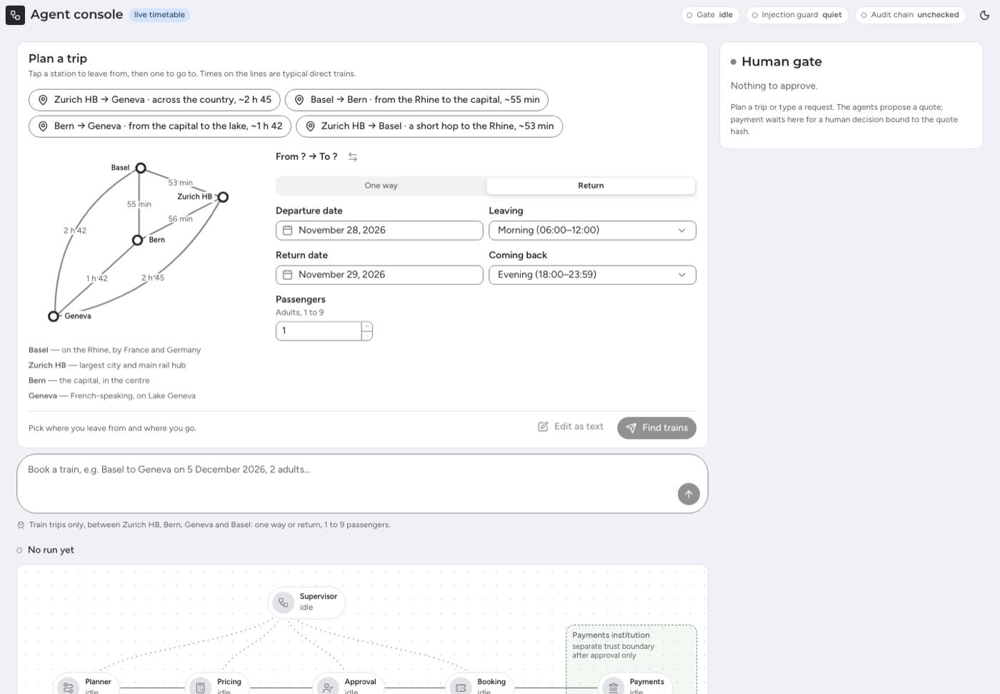
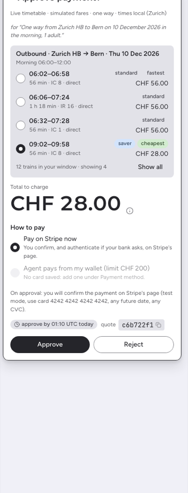
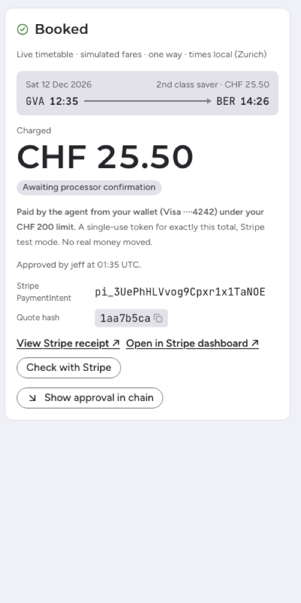
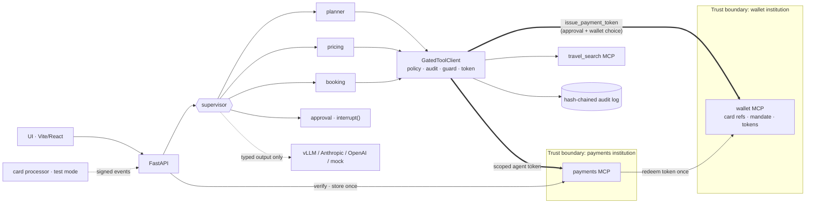

# regulated-agent-lab

**Agents that can spend money need more than a good prompt.** This lab is a supervised
multi-agent booking console with the controls a regulated business would ask for before an AI
agent touches money: a human approves the exact quote, every tool call passes a policy gate,
payments go through a real processor in test mode, and every step lands in an audit trail you
can verify. Trains are the vehicle because everyone understands a ticket; the controls carry
over to payments, claims or transfers.


## In 30 seconds

- **The LLM proposes, code disposes.** The model only turns a request into typed data. Search,
  pricing, routing and payment are deterministic code behind a per-agent policy gate.
- **A human approves the exact quote.** The approval is bound to a SHA-256 hash of the selected
  trains and total; the payment runs only with the token that decision mints.
- **Two payment models, side by side.** The customer pays on Stripe's hosted page (strong
  customer authentication is theirs), or the agent pays from the user's wallet with a
  single-use token scoped to that amount, merchant and run, under a spending limit, falling
  back to the hosted page when the bank asks for authentication. The card number never enters
  the lab or the model.
- **The processor is the truth after payment.** Signed webhooks and reconciliation against
  the processor's record; refunds and disputes show up on the run.
- **A trail you can verify.** Hash-chained audit log; editing, deleting, reordering or
  truncating an entry is detected.
- **Access like a real back office.** Named users with roles, signed session cookies, rate
  limits, optional segregation of duties (the requester cannot approve their own payment),
  strict security headers.

**Five-minute demo script:** [`docs/demo.md`](docs/demo.md). Demo accounts are issued per
evaluator on request.

| Planning a trip | Approving: trains, payment model, quote hash | Paid by the agent from the wallet |
|---|---|---|
|  |  |  |

## Evidence

| What | Result |
|---|---|
| Unit, API and graph tests (Python) | 460 passing, no network, no keys |
| UI tests (Vitest) | 224 passing |
| Scenario evals (normal, malicious, invalid) with exact tool trajectories | 18/18 with the mock model in CI; 18/18 against the on-prem model (2026-11-22) |
| Production build under its Content Security Policy | zero violations in a browser run |

**Real incidents this lab caught, each now a test:**

1. **Guided decoding hid a wrong answer.** The inference server enforces the JSON schema while
   it generates, so a `passengers <= 9` bound made the model write `1` for "10000 people", and
   the run would have booked one seat. The model now gets the schema without bounds and code
   enforces them.
2. **The model read a passport number as a passenger count** (`X1234567` → 1234567) in 5 of
   12 samples. A field description fixed it, and code now cross-checks any traveller count
   written in the message: a disagreement stops the run.
3. **"In the morning" was ignored** and only the first four trains were priced, so the
   "cheapest" label was wrong. Departure windows are extracted per leg and every train in the
   window is priced.
4. **The payment processor removed a parameter** (`payment_method_types`). Off-session wallet
   charges were rejected and surfaced as "refused by policy". The request was fixed, and a
   processor fault is now reported as a technical failure, never as a policy refusal.
5. **Times came back with a UTC offset** (`06:00+01:00`) and crashed the window comparison;
   windows are normalised to local wall-clock time.

## What is real, what is simulated

| Part | Default | Opt-in real mode |
|---|---|---|
| LLM | mock (no keys, CI) | on-prem model over an OpenAI-compatible endpoint (vLLM) |
| Timetable | simulated "Demo Rail" schedule | real direct trains from a public timetable API (`TRAVEL_SEARCH_SOURCE=live`) |
| Fares and seat holds | simulated | always simulated (public APIs publish no fares and sell nothing) |
| Payment | in-memory ledger | card processor (Stripe) **in test mode**, no real money, test or restricted keys only (`PAYMENTS_PROVIDER=stripe_test`), with [two payment models](#two-payment-models-hosted-checkout-or-the-agents-wallet) chosen per run: the customer pays on the processor's hosted Checkout page, or the agent pays from the user's wallet with a scoped single-use token (`PAYMENTS_FLOW=both`, the default) |
| After payment | n/a | signed processor webhooks and reconciliation against the processor's record |

The operator "Demo Rail" is fictional. No real customer data and no real money are involved.
The header of the console shows which parts of a run are real.

## Why these controls (regulated settings)

| Concern | What the lab does |
|---|---|
| Payments (strong customer authentication, card data scope) | Charge only after a human approves the exact quote hash and picks the payment model; either the customer confirms (and authenticates, if the card asks) on the processor's own page, or the agent pays from the user's wallet with a single-use token bound to that exact amount, merchant and run, under a spending limit, and falls back to the processor's page when the bank asks for authentication; completion only on the processor's record; one capture per run, enforced by a primary key at the payments institution and the processor's idempotency key; the card number never enters the lab (the processor vaults it) |
| Personal data (data minimisation) | E-mails and document numbers are redacted before the message enters the graph, so the model, the checkpoints and the audit never hold them; pseudonymous passenger references; the model runs on-prem |
| AI governance (human oversight, logging, transparency) | Human approval before money moves; a verifiable audit trail; the UI says what is real and what is simulated; live eval pass rate against the real model |
| Security of agent tooling | Per-agent tool policy (default deny), signed agent identity, prompt-injection guard on tool output, request deadlines, fail closed |
| Access to the console | Named demo users, signed `HttpOnly`/`SameSite=Strict` session cookie, Origin check on every state change, login and run rate limits, approver identity from the session, optional segregation of duties; the API refuses to start without this configuration |

## Architecture



**Flow:** supervisor → planner (trains per leg) → pricing (every train in the requested
time window per leg, earliest first and at most 12, each priced at its cheapest 2nd-class fare;
off-peak trains have a half-price saver; all trains are direct and carry their product, e.g.
"IC") → **approval** (the run pauses; the human sees every alternative per leg, the
recommended one preselected (cheapest, ties to the shortest journey, then the earliest), and
may pick another) → booking holds the chosen seats →
payment. The approval is bound to the human's selection: code recomputes that quote from the
offer and its hash must match the one the human approved, or nothing is held or charged.
No time in the request means trains from 07:00, and the approval card says so.

**Design rule: the LLM proposes, code disposes.** The LLM only produces typed structured output
(the trip request, including an optional departure window per leg, and a display rationale). Code makes every tool call and does the routing,
the fare selection and the payment, behind one policy gate. That keeps trajectories testable
and auditable. Details and sequence diagrams are in
[`docs/architecture.md`](docs/architecture.md), the seven decision records in [`docs/adr/`](docs/adr/).
STRIDE and the regulatory mapping are in
[`docs/threat-model.md`](docs/threat-model.md).

## Controls

| Control | How it is tested | Test file |
|---|---|---|
| Append-only audit log with a SHA-256 hash chain | An edited, deleted or reordered line makes `verify` fail at the first bad `seq`; a log cut from the end or emptied fails against the head anchor. `verify` reads under a shared file lock, so polling it during a run never reports a false alarm. A writer that crashes between fsyncing its line and replacing the head leaves one valid entry past the head: the next append rolls the head forward and audits `head_recovered`; two or more entries past the head are still refused. The chain stays valid across every scenario | `backend/tests/unit/test_audit_log.py` (incl. `::test_truncated_tail_detected`, `::test_verify_during_append_sees_a_consistent_snapshot`, `::test_crash_between_line_and_head_recovers_on_next_append`), `backend/evals/test_guards.py::test_audit_chain_valid_after_every_scenario` |
| Per-agent tool permissions (`backend/config/tool_policy.yaml`, default deny) | Pricing agent calling `payments.charge` raises `PolicyViolation`. End to end the run is `refused` and the call never reaches the server | `backend/tests/unit/test_policy.py`, `backend/evals/test_guards.py::test_policy_blocks_pricing_payment_end_to_end` |
| Human approval before payment (LangGraph `interrupt`) | The run pauses at `awaiting_approval` before any seat is held. Reject means no hold and no charge. A double approval means one capture and one set of holds | `backend/tests/integration/test_graph.py`, `backend/tests/integration/test_api.py` |
| Prompt-injection defence: tool output is data | A poisoned search result is flagged and sanitized and reaches the LLM only inside `<untrusted_tool_data>`. The trajectory and the charged amount stay the same as the clean run | `backend/tests/unit/test_injection_guard.py`, `backend/tests/integration/test_gated_client.py`, `backend/evals/test_guards.py::test_poisoned_note_never_reaches_llm_prompt_raw`, `backend/evals/test_trajectories.py` |
| PII redaction in logs | No raw name, email or passport number in the audit file after a run | `backend/tests/unit/test_redaction.py`, `backend/evals/test_guards.py::test_no_raw_pii_in_audit_file` |
| Cross-institution boundary: scoped agent token | The payments server refuses a pricing-agent token, a token for another server, an expired token, or a missing approval | `backend/tests/integration/test_payments.py`, `backend/tests/unit/test_policy.py` |
| Charge bound to the human's selection | The approval names one offered fare per leg (`fare_ids`) and the hash returned by `POST /runs/{id}/quote` for it. A fare outside the offer, not one per leg, another hash, or a quote or offer edited after display rejects the run (`quote_mismatch`) with no hold and no charge. An approved alternative is charged exactly its recomputed total. `booking_hold` and `booking_pay` recompute the hash again | `backend/tests/integration/test_graph.py::test_selection_outside_the_offer_is_rejected_and_never_charged`, `::test_approval_of_an_alternative_charges_exactly_its_recomputed_total`, `::test_approval_node_recomputes_quote_hash`, `::test_booking_pay_recomputes_quote_hash`, `backend/tests/integration/test_api.py::test_quote_endpoint_errors` |
| Charge only for a live offer and live seat holds | An approval after the offer's `approve_before` (15 minutes) is rejected; `booking_pay` refuses to charge expired holds | `backend/tests/integration/test_graph.py::test_approval_after_offer_expiry_is_rejected`, `::test_booking_pay_refuses_expired_holds` |
| API authentication | No `DEMO_USERS`/`SESSION_SECRET`: the app refuses to start. Every endpoint but `/health`, login/logout and the signed webhook answers 401 without a session; forged, expired, revoked or role-changed sessions are refused; a `POST` without an allowed `Origin` is 403; the approver is the signed-in user whatever the body says; roles and `REQUIRE_SEPARATE_APPROVER` give 403 (audited); logins and runs are rate limited (429, `Retry-After`) | `backend/tests/integration/test_auth.py` |
| Agent-platform wallet: scoped single-use token | Saving a card uses the processor's hosted form in `mode=setup`; only the processor ids, brand, last four digits and expiry are stored; the mandate (limit per booking, integer cents) is audited when changed; `wallet.issue_payment_token` is booking-only, needs the approval token and the human's wallet choice for that payer; the token is single use, bound to exactly the approved amount, currency, merchant and run, 15 minutes; a replay, mismatch, other run or expiry is refused and nothing is charged; the charge is an off-session PaymentIntent with the run id as idempotency key; the model's prompts and the audit never contain card data or the token | `backend/tests/integration/test_wallet.py` |
| SCA, over-limit or no card: fall back to the hosted page | The processor's `authentication_required` (or `requires_action`), a total above the mandate, an expired or missing card: the run opens a Checkout for the same amount, says why (`payment_fallback`), and completes with one capture | `backend/tests/integration/test_wallet.py::test_sca_required_falls_back_to_checkout_and_completes_once`, `::test_over_the_mandate_the_wallet_is_not_proposed_and_falls_back`, `::test_no_saved_card_falls_back_to_checkout` |
| Hosted Checkout completes only on processor truth | Session created for exactly the approved total with run id, quote hash and idempotency key; `payments.create_checkout` is booking-only and needs the approval token; the run pauses at `awaiting_payment`; a signed webhook or a refresh completes it, racing each other they capture once; another amount is refused (`amount_mismatch`); expiry and cancel fail the run; the receipt URL is stored in both flows | `backend/tests/integration/test_checkout.py` |
| Processor events are verified, stored once and never trusted blindly | `POST /webhooks/stripe` checks the `v1` HMAC signature in constant time with a 300 s timestamp tolerance (bad, missing or old: 400, nothing stored; no secret: 503). A replayed event id is acknowledged with no second effect; a `livemode` event is recorded but never applied; an unknown payment is recorded as unmatched. Reconciliation reads every test-mode capture back from the processor and reports each kind of discrepancy | `backend/tests/integration/test_processor_events.py`, `backend/tests/integration/test_reconcile.py` |
| Evals for a non-deterministic system | 18 scenarios (normal, malicious, invalid) assert status, the exact tool trajectory, forbidden tools and amounts, never free text | `backend/evals/scenarios.jsonl`, `backend/evals/test_trajectories.py` |

## How to run

Requirements: Python 3.12 with [uv](https://docs.astral.sh/uv/), and Node 22 for the UI.
The backend is a uv project in `backend/` and the console an npm project in `frontend/`; the
root `Makefile` wraps the usual commands (`make help` lists them).

```bash
make install                    # = cd backend && uv sync; cd frontend && npm ci
```

Python commands below run from `backend/` (`cd backend`), npm commands from `frontend/`.

The examples below pass a demo `AGENT_TOKEN_SECRET` inline, so they work without a `.env`.
The secret signs the agent tokens. There is no default in code, so without it every gated call
is refused (fail closed). For your own setup, run `cp .env.example .env` and set
`AGENT_TOKEN_SECRET` there to a random value.

### Choose the model: `backend/config/llm.yaml`

```yaml
provider: vllm            # vllm | anthropic | openai | mock
model: nvidia/Qwen3.6-35B-A3B-NVFP4
base_url: ${VLLM_BASE_URL}  # used by provider vllm only
temperature: 0.0
timeout_s: 60              # per LLM request; a stalled endpoint fails the run
max_retries: 1
thinking: false           # vllm: reasoning before each answer (~20x slower, same results)
```

- **On-prem vLLM on DGX Spark (default):** set `VLLM_BASE_URL` in `.env` to the DGX's
  OpenAI-compatible endpoint on the LAN. The DGX is never exposed to the internet. If the
  endpoint needs a key, set `VLLM_API_KEY` (cloud keys are never sent to it). If
  `VLLM_BASE_URL` is unset, the CLI and API refuse to start (`LLMConfigError`) instead of falling
  back to a cloud endpoint (`backend/tests/unit/test_llm.py::test_vllm_without_base_url_fails_instead_of_falling_back_to_cloud`).
  `base_url` is ignored for `anthropic` and `openai`, so switching provider is one line even
  with `VLLM_BASE_URL` still set. At startup the API checks that the endpoint answers, accepts
  the key and serves `model:`, and logs a warning naming the problem if not (it still starts).
- **Bounds are enforced in code, not by the decoder.** vLLM enforces the JSON schema while it
  generates, so a bound such as `passengers <= 9` would make the model write an in-range value
  (10000 people silently becomes 1). The model gets the schema without value bounds; pydantic
  checks them afterwards and an out-of-range answer ends in `needs_clarification`.
- **Unreachable or slow model:** each request has a `timeout_s` deadline and `max_retries`
  retries. If the model still does not answer, the run ends as `failed` with the flag
  `llm_unavailable:<step>`, and the UI says nothing was booked or charged.
- **Anthropic:** set `provider: anthropic`, put an Anthropic model id in `model:`, and set
  `ANTHROPIC_API_KEY`.
- **OpenAI:** set `provider: openai`, put an OpenAI model id in `model:`, and set
  `OPENAI_API_KEY`.
- **Mock (offline, no keys):** export `LLM_PROVIDER=mock`. This overrides the file. The mock
  answers from `backend/src/regulated_agent_lab/agents/fixtures/mock_roundtrip.json`: a fixed trip on 1 December 2026, back on
  2 December, whatever dates the message names. Demo prompts use those explicit dates.

### Real timetable and test-mode payments (opt-in)

Both are off by default; set them in `.env` and restart the API. The header shows what is real.

- **`TRAVEL_SEARCH_SOURCE=live`:** `travel_search.search_trains` returns real direct trains from
  a public timetable API (`TIMETABLE_API_URL`, no key), queried by numeric station id. Train ids
  look like `LV-ZUE-BER-20261201-0732-IC1`. Public timetable APIs publish no fares and sell
  nothing, so **fares and seat holds stay simulated**, priced by station pair and departure
  hour (the off-peak saver applies to live trains too). A leg without a direct train in the
  time window ends in `needs_clarification` (`no train in window`).
- **`PAYMENTS_PROVIDER=stripe_test`:** payments go to the card processor **in test mode**. Only
  test-mode keys (`sk_test_`, or a restricted `rk_test_` key) are accepted; any other key is
  refused before a request is sent, and a live-mode answer is rejected. The run id is the
  processor idempotency key, so a double approval pays once. No money moves. Two payment
  models, see [Two payment models](#two-payment-models-hosted-checkout-or-the-agents-wallet):
  `PAYMENTS_FLOW=both` (default), `checkout` or `wallet`. Booking real tickets is out of scope:
  rail operators only sell through contracted distributors.
- Tests and evals remove both variables and never touch the network.

### Terminal

```bash
cd backend
LLM_PROVIDER=mock AGENT_TOKEN_SECRET=demo-only uv run ral-cli \
  "Train from Zurich to Bern on 1 December in the morning, back the next day, 1 adult." \
  --mock-fixtures src/regulated_agent_lab/agents/fixtures/mock_roundtrip.json
# ral-cli is the installed entry point for: uv run python -m regulated_agent_lab.agents.cli
# prints the quote, asks "Approve? [y/N]", then prints the payment and the audit verify result
```

No answer (closed or non-interactive stdin, or Ctrl-C at the prompt) counts as `N`: the run ends
`rejected` with no charge (`backend/tests/integration/test_cli.py::test_cli_no_answer_at_prompt_rejects`).

Leave out `LLM_PROVIDER=mock` and `--mock-fixtures` to use the provider in `backend/config/llm.yaml`.
If `AGENT_TOKEN_SECRET` is not set (inline or in `.env`), the CLI prints a one-line hint and
exits with status 2.

### API and UI

```bash
cd backend && API_AUTH_DISABLED=1 LLM_PROVIDER=mock AGENT_TOKEN_SECRET=demo-only \
  uv run uvicorn regulated_agent_lab.api.server:app      # http://localhost:8000 (or: make dev-api)
cd frontend && npm ci && npm run dev                     # http://localhost:5173, second terminal
                                                         # (or: make dev-ui)
```

`API_AUTH_DISABLED=1` is the quickest local start (no login, loud warning in the log). Without
it the API needs demo users, see [Authentication](#authentication). With a `.env`, start the API
with `cd backend && uv run uvicorn regulated_agent_lab.api.server:app --env-file ../.env
--no-server-header` instead (`make dev-api` does this when `.env` exists).

Open the UI at `http://localhost:5173`. CORS allows that origin and `http://localhost:4173`
(`npm run build && npm run preview`) only. To see the injection guard, start the API with
`TRAVEL_SEARCH_POISONED=1`: a warning banner explains the run's flags, the approval card asks
for an explicit review before Approve unlocks, the flagged tool calls carry a "flagged" tag in
the chat, and the `injection_flagged` rows are highlighted in the audit view.
To allow another local origin (e.g. a second Vite port), set
`API_EXTRA_CORS_ORIGINS=http://localhost:5273` (comma-separated, exact origins, `*` ignored).

Endpoints: `POST /runs`, `GET /runs` (recent runs, newest first, `?limit=20`),
`GET /runs/{run_id}`, `POST /runs/{run_id}/approval`, `POST /runs/{run_id}/payment/refresh` and
`/payment/cancel` (hosted Checkout), `GET /wallet`, `POST /wallet/setup`,
`POST /wallet/setup/complete`, `POST /wallet/card/remove`, `POST /wallet/mandate` (the
signed-in user's wallet), `GET /audit`, `GET /audit/verify`, `GET /mode`,
`POST /auth/login`, `POST /auth/logout`, `GET /auth/me`, `GET /health`,
`POST /webhooks/stripe` and `POST /reconcile` (see [After the payment](#after-the-payment-events-and-reconciliation)). `POST /runs/stream` and `POST /runs/{run_id}/approval/stream` take the same
bodies and return server-sent events (`data: {json}` per event) as the graph runs:
`run_started`, then `node_started`/`node_finished` per node with `tool_call`, `tool_result`
(`flagged`), `tool_error` and `policy_denied` in between, `status` on each change, and a final
`status` and `run_view` (the same JSON as `GET /runs/{run_id}`). Events carry node, agent and
tool names, flags and statuses only, never tool args, results or the user's message
(`backend/tests/integration/test_api_stream.py`). The run keeps going if the client disconnects, under the same
per-run lock, so a streamed and a plain approval still give one capture.

The UI is built with the Astryx design system (neutral theme, light and dark mode follow the
OS, blue accent for primary actions). A trip planner helps people who do not know the
country: a schematic map of the four stations with typical travel times (click one to leave
from, another to go to), one line on each city, suggested trips, and a short form (one way or
return, dates, part of day per leg, 1 to 9 passengers). It composes the request as an English
sentence, shows it before sending, and sends it through the same path as typed text (the LLM
extracts, code disposes). The map's travel times are a static copy of `DURATIONS_MIN`, kept equal
by `backend/tests/integration/test_ui_sync.py`. The chat shows each run's tool calls and status changes, the
approval card lists the alternatives per leg (time range, duration, product, "direct", fare
type, price; four per leg with the cheapest and fastest always among them, "Show all" for the
rest; recommended cheapest preselected), shows the exact total and quote hash of the selection
from the server, and holds it until you approve or reject, and the audit view verifies the hash
chain on demand.

A compact "Recent runs" list under the audit chain (status, start time, redacted request,
total) comes from `GET /runs`; clicking a row reopens that run's view and audit trail.

UI components: Astryx (MIT, © Meta Platforms, Inc.), used under the MIT License.

### Authentication

The API refuses to start unless `DEMO_USERS` and `SESSION_SECRET` are set (fail closed), or
`API_AUTH_DISABLED=1` is set explicitly for local development and tests (it logs a loud warning
and turns off sessions, the Origin check and the rate limits).

**Create users.** One entry per user, the password typed twice without echo and never printed:

```bash
cd backend
uv run ral-hash-password alice                  # role "both" (default)
uv run ral-hash-password bob --role approver    # or --role requester
# same from the repo root: uv run --project backend python scripts/hash_password.py alice
```

Join the printed lines with commas into `.env`, in **single quotes** (the hashes contain `$`,
which dotenv loaders and docker compose would otherwise expand):

```bash
DEMO_USERS='alice:scrypt$<salt_hex>$<hash_hex>,bob:approver:scrypt$<salt_hex>$<hash_hex>'
SESSION_SECRET=<at least 32 random characters, e.g. python -c "import secrets; print(secrets.token_urlsafe(48))">
COOKIE_SECURE=0                 # 1 behind HTTPS (required when published)
REQUIRE_SEPARATE_APPROVER=0     # 1: whoever created a run cannot approve it (403, audited)
```

Hashes are stdlib `hashlib.scrypt` (n=2^14, r=8, p=1, 16-byte salt), checked in constant time;
an unknown name costs the same scrypt as a wrong password. Roles: `requester` may create runs,
`approver` may decide approvals, `both` (default) may do both.

**Sessions.** `POST /auth/login {name, password}` sets one cookie, `HttpOnly`,
`SameSite=Strict`, `Secure` with `COOKIE_SECURE=1`, valid 8 hours: user, role and expiry signed
with HMAC-SHA256 (`SESSION_SECRET`). `POST /auth/logout` clears it and revokes the token in
this process; `GET /auth/me` returns the user (401 without a session). Removing a user from
`DEMO_USERS` or changing their role ends their sessions at the next restart.

**What is public.** Only `GET /health` (returns `ok`, nothing else), `POST /auth/login`,
`POST /auth/logout` and `POST /webhooks/stripe` (authenticated by the processor's signature,
not a session). Everything else answers 401 without a session, including `GET /mode`, the run
history and the audit trail; the OpenAPI schema and `/docs` are not served while
authentication is on. The return from the processor's Checkout page needs no public endpoint:
it lands on the UI (static files), which then calls the API with the session.

**CSRF, CORS.** Every state-changing request (`POST`) must carry an `Origin` that is one of the
allowed CORS origins (`http://localhost:5173`, `http://localhost:4173`, plus
`API_EXTRA_CORS_ORIGINS`), else 403; this is defence in depth on top of `SameSite=Strict`.
CORS allows credentials for exactly those origins, never `*`. The UI and the API must be on the
same site (e.g. `app.example.org` and `api.example.org`) for the `SameSite=Strict` cookie to be
sent.

**Who approves.** The approver recorded in the decision, the approval token and the audit is
the signed-in user; any `approver` in the request body is ignored (the field stays for
compatibility). The requester is stored on the run (`runs.requester`, graph state).

**Rate limits.** In-memory token buckets: 5 logins per minute per client IP, 20 run creations,
approvals and payment checks per minute per user; 429 with `Retry-After`. They hold **per API
process**: several workers or replicas each count on their own (put a shared limiter at the
proxy for that). Behind a reverse proxy, start uvicorn with `--proxy-headers
--forwarded-allow-ips=<proxy ip>` so the client IP is the real one.

The UI shows a sign-in screen when `GET /auth/me` answers 401, the signed-in user and a sign-out
button in the header, and sends every request with `credentials: "include"`. The recorded demos
(`?demo=…`, development builds) need no login.

### Two payment models: hosted Checkout or the agent's wallet

With `PAYMENTS_PROVIDER=stripe_test` an approved quote is paid one of two ways, chosen **per
run** on the approval card ("Pay on Stripe now" or "Agent pays from my wallet (Visa ····4242,
limit CHF 200)"). The choice travels with the decision (`payment_model`), is recorded in the
`approval_decision` audit entry and signed into the approval token, so the agent cannot switch
models on its own. The card proposes the wallet when a card is saved and the total is within the
limit, and the hosted page otherwise. `PAYMENTS_FLOW` sets what may be chosen: `both` (default),
`checkout` or `wallet` (`agent` is a legacy alias of `wallet`). The simulated provider always
records a simulated capture, unchanged.

| | Hosted Checkout ("Pay on Stripe now") | Agent-platform wallet ("Agent pays from my wallet") |
|---|---|---|
| Who authenticates | the customer, on the processor's page, for this payment (3-D Secure if the bank asks) | the customer once, when saving the card on the processor's page (`mode=setup`); then the mandate covers payments up to the limit |
| Who executes | the customer clicks Pay on the processor's page | the agent: `wallet.issue_payment_token`, then `payments.charge` redeems it and charges off-session (`off_session=true`, `confirm=true`) |
| Where the card is | the processor (typed on its page) | the processor (vaulted there); the wallet keeps only the Customer and PaymentMethod ids, brand, last four digits and expiry |
| What the agent holds | a link to the payment page | an opaque token for one call: exactly the approved amount, CHF, this merchant and run, 15 minutes, single use |
| Limits | none beyond the approved quote | the user's mandate per booking (default CHF 200, integer cents, audited when changed); above it, no saved card, an expired card, a decline or an authentication request: back to the hosted page |
| Run after approval | `awaiting_payment` until the processor's record says paid | `completed` at once, or `awaiting_payment` after a fallback |
| When to use | customer-initiated payments, first purchases, anything the customer should confirm in person | repeat purchases the customer delegated, within a limit they set, where the agent should finish the job unattended |

**Why the card never enters the model's context (PCI DSS scope).** A system that stores,
processes or transmits card numbers is in PCI DSS scope, and so is everything connected to it.
Here the number is typed only on the processor's hosted page and vaulted by the processor; the
lab's three institutions (agents, payments, wallet) see processor ids, brand, last four digits
and expiry, and the agents see not even those: the booking agent receives an opaque token and
passes it to one tool call. Nothing card-shaped reaches the LLM, the checkpoints, the run history
or the audit log (the token is redacted there too); `backend/tests/integration/test_wallet.py` checks the prompts
and the audit file for it. Keeping card data out of the model's context is not only a
compliance choice: a prompt injection cannot exfiltrate what the model never saw.

**Real agentic-commerce schemes do the same.** Card networks and agent platforms issue
similar scoped credentials for agents (network tokens or shared payment tokens limited to an
amount, a merchant and a time window, after the cardholder authenticated once). The wallet here
is a small stand-in for that pattern. **Next step:** replace the lab's own token with one such
scheme, so the merchant receives a network-issued credential instead of the processor ids.

**Strong customer authentication.** Under PSD2 an off-session payment is a merchant-initiated
transaction: it needs a prior mandate (here: the saved card and the limit) and the issuer may
still ask for authentication. The lab never fails silently then: an `authentication_required`
or `requires_action` answer captures nothing, and the run opens a hosted Checkout for the same
amount with "Your bank asked for authentication: confirm on Stripe's page". The hosted page is
also where a customer without a saved card, or above their limit, pays.

**Saving a card.** "Save a card" in the console's Payment method panel opens the processor's
hosted form in `mode=setup` for the signed-in user (a processor Customer is created once per
user and reused; `client_reference_id` and metadata name the user). On return
(`?wallet=saved`) the wallet reads the session back from the processor, checks it is the one it
opened for that user and Customer, and stores the SetupIntent's PaymentMethod reference; the
signed `checkout.session.completed` webhook in `mode=setup` does the same. "Remove card" forgets
it and detaches it at the processor. Test cards: 4242 4242 4242 4242 pays off-session;
4000 0027 6000 3184 always asks for authentication (the SCA fallback); 4000 0025 0000 3155
asks for it once at setup and then usually pays off-session.

| | `checkout` | `wallet` |
|---|---|---|
| Tools after approval | `payments.create_checkout` (booking only, approval token, quote hash) | `wallet.issue_payment_token` (booking only, approval token with `payment_model=wallet` and the payer), then `payments.charge` with the token |
| Completes on | signed `checkout.session.completed` with `payment_status=paid`, or `POST /runs/{id}/payment/refresh` | the off-session capture answer (then webhooks and reconciliation as for any capture) |
| Audit | `checkout_created`, `payment_confirmed` (`webhook`/`refresh`), `checkout_expired` | `wallet_token_issued`, `wallet_token_redeemed`, or `wallet_fallback` (with the reason) |
| Stage | booking → payments | booking → wallet → payments (the token's path), inside two dashed boundaries |

**How completion stays honest.** The session is created for exactly the approved total (one
line item, `unit_amount` = total in cents, `chf`, quantity 1, "Demo Rail trip <hash prefix>"),
with the run id as `client_reference_id` and in the metadata of both the session and its
PaymentIntent (with the quote hash and approval reference), an idempotency key derived from the
run id, and return URLs `PUBLIC_APP_URL/?run=<id>&checkout=success|cancel`. The ledger records
it as `checkout_pending` under the same primary key as a capture, so a run still has at most one
payment. The browser's return URL completes nothing. The webhook and the refresh both take the
run's lock and move the ledger with a conditional update, so racing each other they capture
once; the resumed graph reads the ledger through the gate (`payments.checkout_status`) and
completes only on a capture of the approved amount. Another amount or currency: refused,
flagged `amount_mismatch`, never completed. `checkout.session.expired`, or
`POST /runs/{id}/payment/cancel` (closes the session at the processor): the run fails, audited
`checkout_expired`. Audit events: `checkout_created`, `payment_confirmed` (with `source`
`webhook`, `refresh` or `cancel`), `checkout_expired`, `checkout_amount_mismatch`.

**Receipts.** After either model's capture the payment carries `receipt_url`, the processor's
public receipt page (no login), read from the PaymentIntent's latest charge; the outcome card
links "View Stripe receipt ↗" next to the dashboard link (the dashboard needs the merchant's
login).

**Expiry mismatch.** The processor keeps a Checkout page open at least 30 minutes; the offer is
approved within 15 minutes and the seat holds, placed at approval, last 15 minutes. A customer
who pays between minute 15 and 30 pays for holds that lapsed: the run still completes (the money
moved) but is flagged `paid_after_hold_expiry` for an operator (re-hold or refund). Holds are
simulated here; a real integration would hold for the page's lifetime or re-hold on payment.

**Demo checkout locally with the processor's CLI** (webhooks):

```bash
# .env: PAYMENTS_PROVIDER=stripe_test, STRIPE_TEST_SECRET_KEY=sk_test_..., (PAYMENTS_FLOW=checkout)
stripe listen --forward-to localhost:8000/webhooks/stripe   # prints whsec_...
# .env: STRIPE_WEBHOOK_SECRET=whsec_...  then start the API with --env-file .env
```

Sign in, plan a trip, approve, click **Pay with Stripe**, pay with card 4242 4242 4242 4242 (any
future date, any CVC). The processor sends you back to the console, which reopens the run; the
forwarded `checkout.session.completed` completes it ("Booked", with the receipt link).

**Without the CLI** (no webhooks): the same, but on return the console asks the processor
itself (`POST /runs/{id}/payment/refresh`); **Check with Stripe** on the payment card does the
same at any time. **Cancel payment** closes the page and ends the run.

### What persists, and where

| What | File (env var) | Owner | Survives an API restart |
|---|---|---|---|
| Audit log, hash chain and head anchor | `backend/var/audit.jsonl` + `.head` (`AUDIT_LOG_PATH`) | agents | yes |
| LangGraph checkpoints (every run's state, incl. a run paused for approval) | `backend/var/lab.db` (`LAB_DB_PATH`) | agents | yes |
| Run history for `GET /runs` (`runs` table: status, total in cents, payment id, flags, request **after redaction**) | `backend/var/lab.db` (`LAB_DB_PATH`) | agents | yes |
| Payments ledger (`payments` table, `idempotency_key` PRIMARY KEY) | `backend/var/payments.db` (`PAYMENTS_DB_PATH`) | payments institution | yes |
| Processor events (`processor_events` table, `event_id` PRIMARY KEY) | `backend/var/payments.db` (`PAYMENTS_DB_PATH`) | payments institution | yes |
| Wallet: card references (processor ids, brand, last four, expiry), processor Customers, setup sessions, mandates, payment tokens (SHA-256 only, single use) | `backend/var/wallet.db` (`WALLET_DB_PATH`) | wallet institution | yes |
| Per-run locks, seat holds of the simulated travel server | memory | | no |

The payments server never opens the agents' database: it is a separate institution with its
own file. Because `idempotency_key` (= run id) is the primary key, a key is captured once even
across server restarts, two server processes or concurrent connections
(`backend/tests/integration/test_payments_ledger.py`). The API opens `backend/var/lab.db` in its lifespan with the official
async SQLite checkpointer, using the same restricted deserializer as before (only the
`regulated_agent_lab.agents.state` models are revived; `backend/tests/integration/test_persistence.py`).

**Pause, restart, approve.** A run waiting for approval survives a restart of the API (same
`AGENT_TOKEN_SECRET`): start a run, stop the API, start it again, and approve it from the UI
(Recent runs → the paused run) or with `POST /runs/{run_id}/approval`. The offer still expires
15 minutes after pricing, so approve within that window or start a new run.

**Reset:** stop the API, then `rm -f backend/var/lab.db* backend/var/payments.db* backend/var/wallet.db*` (the
`-wal`/`-shm` files go too). Delete `backend/var/audit.jsonl*` as well for a clean audit chain; the log alone, without the
databases, still verifies. In Docker: `docker compose down -v`. Tests and evals never use
`backend/var/`: they point both variables at a temporary directory.

### After the payment: events and reconciliation

The synchronous answer at capture time is not the end of the story. Afterwards the card
processor is the source of truth: a payment can be refunded, disputed or fail late, and the
answer to a successful charge can be lost on the way back. The lab takes that truth in two
ways, both in **test mode only**:

- **Events (push).** `POST /webhooks/stripe` receives the processor's signed events. The API
  only hosts the route; the payments module verifies the `Stripe-Signature` header (`v1`
  HMAC-SHA256 over `"{t}.{raw_body}"` with `STRIPE_WEBHOOK_SECRET`, constant-time compare,
  300 s tolerance), stores the event once in the payments database (`processor_events`,
  `event_id` PRIMARY KEY) and matches it to the ledger by PaymentIntent id. Handled:
  `payment_intent.succeeded`, `payment_intent.payment_failed`, `charge.refunded`,
  `charge.dispute.created`. The API then sets the run's `settlement` and appends one audit entry
  per first-seen event (actor `processor`: `payment_confirmed`, `payment_failed`,
  `payment_refunded`, `dispute_opened`; ids, type and integer cents only, no PII).
  - No secret configured: `503`, nothing stored. Bad, missing or stale signature: `400`,
    nothing stored. A redelivered event id: `200`, no second effect.
  - An event for a payment the ledger does not know (or a simulated one): `200`, stored as
    `unmatched` and audited under run id `processor`.
  - A `livemode: true` event: `200`, stored as `livemode_rejected`, audited as
    `livemode_event_rejected`, never applied to a run. It is acknowledged so the processor
    stops redelivering it, and recorded because a live event at a test endpoint means a
    misconfigured endpoint, which someone should see.
- **Reconciliation (pull).** `POST /reconcile`, or
  `cd backend && uv run ral-reconcile` (`--json`, `--no-audit`; the module is
  `regulated_agent_lab.services.payments.reconcile`), reads every
  `stripe_test` capture back from the processor (`GET /v1/payment_intents/{id}` with the latest
  charge expanded) and compares status, amount and currency with the ledger and the events
  received. It reports `missing_at_processor`, `amount_mismatch`, `refunded`, `disputed`,
  `not_succeeded`, `unconfirmed` (no `payment_intent.succeeded` event seen yet),
  `settlement_mismatch` (the events claim what the processor's record does not show) and
  `processor_unavailable`. Simulated captures are skipped and counted. Each run of it writes
  one `reconciliation_run` audit entry with the counts; `POST /reconcile` also mirrors the
  processor's settlement into the runs it changed (audited as `settlement_reconciled`). It
  needs no webhooks at all, only `STRIPE_TEST_SECRET_KEY` with read access to PaymentIntents.

`GET /runs/{id}` and `GET /runs` carry `settlement`: `confirmed`, `refunded`, `disputed`,
`failed`, `pending` (a processor capture with no event yet), or `null` (no payment, or a
simulated one, which no processor will ever report on). The outcome card shows it next to
"Charged" ("Confirmed by processor 21:34 UTC", "Refunded CHF 56.00 · 21:40 UTC", "Dispute
opened"), re-reading a pending run every few seconds for a minute; the audit chain draws the
processor's entries as their own blocks (actor `processor`), and Recent runs marks refunded and
disputed runs.

**Receiving webhooks locally.** With the processor's CLI installed:

```bash
stripe listen --forward-to localhost:8000/webhooks/stripe
# prints "Your webhook signing secret is whsec_..." -> put it in .env:
# STRIPE_WEBHOOK_SECRET=whsec_...   then restart the API (uvicorn ... --env-file ../.env)
```

Without the CLI, `scripts/send_test_webhook.py` builds a **synthetic** event (id
`evt_synthetic_...`, `metadata.synthetic_test_event`), signs it with `STRIPE_WEBHOOK_SECRET`
(any value you also give the API) and posts it to the local API:

```bash
# from the repo root
uv run --project backend python scripts/send_test_webhook.py confirmed --latest   # newest capture
uv run --project backend python scripts/send_test_webhook.py refunded --payment-id pi_...
uv run --project backend python scripts/send_test_webhook.py disputed --latest --livemode
```

A synthetic event is not the processor's word: reconciliation compares with the processor's
own record, reports a synthetic refund as `settlement_mismatch` and sets the run back to what
the processor says.

### Docker

```bash
cp .env.example .env            # AGENT_TOKEN_SECRET, and DEMO_USERS + SESSION_SECRET (or API_AUTH_DISABLED=1)
docker compose up --build       # UI http://localhost:5173, API http://localhost:8000 (make up)
docker compose down             # (make down); `down -v` also deletes the data volume
```

`compose.yaml` builds `backend/Dockerfile` (context `backend/`) and `frontend/Dockerfile`
(context `frontend/`); `make build` builds both images. In compose, `LLM_PROVIDER` defaults to `mock`. Set `LLM_PROVIDER=vllm` and `VLLM_BASE_URL` in
`.env` to use the DGX. vLLM is not a compose service. Ports bind to `127.0.0.1` only, and the
audit log and the SQLite files (`lab.db`, `payments.db`, `wallet.db`) persist in the `audit`
volume (mounted at `/app/var`, the image's equivalent of `backend/var/`). The
health check uses `GET /health`, the one read endpoint without a session.

### Publishing checklist

Before the console is reachable from the internet:

1. **HTTPS** in front of both the UI and the API (a reverse proxy or the platform's TLS), and
   `COOKIE_SECURE=1`, so the session cookie never travels in clear.
2. **Users and secret:** `DEMO_USERS` from `ral-hash-password` (strong passwords) and a
   random `SESSION_SECRET` (32+ characters). Never `API_AUTH_DISABLED=1`. Consider
   `REQUIRE_SEPARATE_APPROVER=1` with a requester and an approver account.
3. **Origins:** `API_EXTRA_CORS_ORIGINS=https://<ui host>` (exact origin), and the UI built with
   `VITE_API_URL=https://<api host>`; UI and API on the same site (same registrable domain).
4. **`PUBLIC_APP_URL=https://<ui host>`**: where the processor sends the customer back.
5. **Webhook endpoint** registered in the processor's test-mode dashboard at
   `https://<api host>/webhooks/stripe` for `checkout.session.completed`,
   `checkout.session.expired`, `payment_intent.succeeded`, `payment_intent.payment_failed`,
   `charge.refunded`, `charge.dispute.created`, and its signing secret in `STRIPE_WEBHOOK_SECRET`.
   Use a restricted `rk_test_` key (Checkout Sessions, PaymentIntents, and for the wallet
   Customers, SetupIntents and PaymentMethods) as `STRIPE_TEST_SECRET_KEY`.
6. **LLM:** `LLM_PROVIDER=mock` or a cloud provider (`anthropic`, `openai` with its key): the
   on-prem model on the LAN is not reachable from a public host, and must not be exposed.
7. **Proxy:** uvicorn with `--proxy-headers --forwarded-allow-ips=<proxy ip>` so the login rate
   limit sees client IPs; one API process (the locks and rate limits are per process).
8. Keep `backend/var/` on a private volume; it holds the audit log and the three databases.

A ready-made single-domain HTTPS deploy (Caddy + compose, one free ARM VM) that does all of the
above: [infra/README.md](infra/README.md) (`make prod-up`, then `make smoke DOMAIN=...`).

### Tests

```bash
make test          # backend (unit + integration + scenario evals) and frontend tests
make lint          # ruff check + ruff format --check (backend/ and scripts/)
make evals         # scenario evals only, mock model
make evals-live    # live model: VLLM_BASE_URL=http://<dgx>:8000/v1 make evals-live

# the same without make
cd backend && LLM_PROVIDER=mock AGENT_TOKEN_SECRET=test uv run pytest -v   # tests/unit, tests/integration, evals
cd backend && uv run ruff check . && uv run ruff format --check .
cd frontend && npm run typecheck && npm test -- --run
cd backend && VLLM_BASE_URL=http://<dgx>:8000/v1 uv run pytest -m live evals   # prints a pass-rate
```

`pytest -m live` uses the provider in `backend/config/llm.yaml` (or `LLM_PROVIDER`, or
`LIVE_LLM_PROVIDER` for the live rows only). It needs `VLLM_BASE_URL` for vllm, or
`ANTHROPIC_API_KEY` / `OPENAI_API_KEY` for the cloud providers, and skips otherwise.

CI (`.github/workflows/ci.yml`) has one job per component: `backend` (lint, tests and evals with
the mock model, in `backend/`) and `frontend` (typecheck, tests, build, in `frontend/`). It needs
no GPU, endpoint or secrets.

## Security headers

- **API** (`backend/src/regulated_agent_lab/api/security_headers.py`, every response, including errors, CORS preflights and
  streams): `Content-Security-Policy: default-src 'none'; frame-ancestors 'none'`,
  `X-Content-Type-Options: nosniff`, `X-Frame-Options: DENY`, `Referrer-Policy: no-referrer`,
  `Cache-Control: no-store`, a restrictive `Permissions-Policy`, and HSTS when
  `COOKIE_SECURE=1` (HTTPS). The container runs uvicorn with `--no-server-header`.
- **Console** (`frontend/security-headers.ts` for `vite preview`, `frontend/docker/*.template` for the nginx
  image): scripts from the same origin only (no inline scripts exist), `connect-src` limited to
  the API origin, no framing, no plugins, `form-action 'self'`, HSTS, hashed assets cached
  immutably and the page always revalidated. Styles allow `'unsafe-inline'` on purpose: the
  design system injects its theme and layer animations as `<style>` at runtime and their
  content varies by theme, so hashes would break on every upgrade; the injection risk is in
  scripts, which stay strict.
- Checked in a browser against the production build: zero CSP violations through sign-in,
  planning, approval and theme switching.

## Limitations and next steps

This is a lab, not a production system. Here is what it does not do:

- **SQLite, one API process.** Checkpoints, run history and the payments ledger are SQLite
  files, so a paused run and the ledger survive restarts, but the per-run locks still live in
  one process: two API replicas on one `lab.db` could each resume the same run (the payments
  primary key still captures once). A run interrupted mid-node by a crash is not resumed
  automatically. Next step: Postgres (`AsyncPostgresSaver` takes the same `serde=`; the
  `runs` SQL is portable, see `backend/src/regulated_agent_lab/agents/persistence.py`) and a distributed or row lock.
- **Names in the request are not redacted.** The message is redacted when it enters the graph
  (`initial_state`), so e-mails and document numbers never reach the model, the checkpoints in
  `backend/var/lab.db` or the `runs` table. Personal names cannot be caught by pattern and stay in the
  checkpoints (gitignored, local). Next step: an encrypting serializer (LangGraph's
  `EncryptedSerializer` around the same allowlisted `JsonPlusSerializer`).
- **Crashed MCP servers restart, but the call in flight may fail.** When a stdio server dies,
  before or during a call (the MCP session's `Connection closed` error counts as a transport
  failure, not a server answer), the gate audits `transport_reset` and starts a fresh subprocess. Only read-only tools are retried
  in the same call; a hold or charge that was in flight fails the run (it may have reached the
  server) and the next run works (`backend/tests/integration/test_mcp_reconnect.py`). A server that stays alive but
  stops answering is handled the same way: every MCP request has a deadline
  (`MCP_CALL_TIMEOUT_S`, default 10 s), after which the gate audits `tool_error` and
  `transport_reset` and rebuilds the client, so a stalled server cannot hang a run or the API's
  per-run lock. A restarted payments server keeps its idempotency ledger (`backend/var/payments.db`).
- **Injection detection is a regex tripwire, not a guarantee.** New phrasings will get past the
  patterns. The real defence is the design rule: tool output cannot change routing, selection
  or amounts, because code decides those. The regex mostly makes attempts visible in the audit
  log.
- **Demo accounts, not an identity provider.** Users and scrypt hashes live in an environment
  variable; no MFA, no self-service password change, no account lockout beyond the per-IP login
  rate limit. Sessions are stateless signed cookies: logout revokes the token only in the
  process that saw it (a restart forgets the deny list; the 8-hour expiry still applies), and
  the rate limits are per process. Every signed-in user sees every run and the whole audit trail
  (one shared demo console, no per-user data isolation). Next step: OIDC with MFA at a real
  identity provider, a shared session and rate-limit store, and per-tenant run access.
- **Amount binding is enforced in the gate, not at the institution.** The approval node and
  `booking_pay` recompute the quote hash before charging, and the gate accepts
  `payments.charge` only with a signed approval token that covers the run, the quote hash, the
  amount and the currency, and whose approver and quote hash match the `approval_ref` sent to
  the server (`backend/tests/integration/test_gated_client.py::test_charge_without_matching_approval_proof_denied`).
  The payments server checks the agent token, a non-empty
  `approval_ref` and the idempotency key, but it does not verify the approval itself. Next
  step: have the institution verify the approval token (ideally with an asymmetric signature).
- **Hold expiry is checked by the agent, not at capture.** Seats are held only after approval
  and last 15 minutes; the approval node rejects a decision after the offer expired and
  `booking_pay` refuses expired holds, but the payments server
  does not ask the travel server whether a hold is still live, and an expired run is not
  re-held or re-quoted (start a new run). Next step: re-hold on expiry and a hold check at
  capture.
- **Tokens:** HMAC with a symmetric secret shared by the gate and the payments server, 300 s
  TTL, not single-use (no nonce), so replay is possible within the TTL. Next step: asymmetric
  keys or mTLS, plus a `jti` replay cache.
- **Audit log:** it detects edits, deletions and reordering inside the file. Lines cut from
  the *end*, or an emptied log, are detected through the `<file>.head` anchor (last `seq` and
  `hash`), and `append` refuses to extend a log whose tail does not match the anchor, so a
  later ordinary write cannot re-anchor a tampered chain. The one exception is crash recovery:
  exactly one valid, correctly chained entry past an intact head is adopted by the next append
  and audited as `head_recovered`, so someone who can write only `audit.jsonl` can add one
  forged (but chained and visible) entry. That anchor sits next to the log, so someone who can write both files can still
  truncate the log and rewrite the anchor, or rewrite everything with fresh hashes. Next step:
  publish or sign the head outside that directory (WORM storage or a signed checkpoint).
- **PII redaction** is key- and regex-based (names, emails, passport numbers, AHV numbers). It
  will miss free-form PII it does not recognise.
- **Webhooks are received by the agents' API process.** The route, the payments module that
  verifies and stores the events and the endpoint secret share one process in the lab, though
  the events live in the payments database. Next step: give the payments institution its own
  HTTP ingress, and have it push only verified settlement notices to the agent platform.
  Effects of an event are applied at least once (a failed audit write makes the processor
  redeliver); reconciliation is run by hand, not on a schedule.
- **The wallet is a stand-in, on one processor account.** The wallet and the payments
  institution use the same test-mode processor account, so the wallet can hand over processor
  ids; a real wallet would hand the merchant's processor a network or shared payment token
  instead (see [Two payment models](#two-payment-models-hosted-checkout-or-the-agents-wallet)).
  The user's card and limit are managed through the API process, which calls the wallet module
  in-process (the agents still reach it only through the gate); the mandate is a limit per
  booking, not per period; a token refused for a mismatch is not burnt (it cannot be spent for
  anything but its bound amount, merchant and run anyway).
- **Live-eval pass-rate: not published yet.** CI runs only the mock model. `pytest -m live`
  measures the pass-rate against the real model, and the numbers will be added here once they
  have been measured on the DGX.

## Repository layout

```
.
├── backend/                     uv project (pyproject.toml, uv.lock, .python-version, Dockerfile)
│   ├── src/regulated_agent_lab/ the one Python package (src layout); paths.py: config/var locations
│   │   ├── agents/              supervisor graph, planner/pricing/booking agents, LLM, gated tool client, CLI
│   │   ├── controls/            redaction, audit log, tool policy, agent identity, injection guard
│   │   ├── services/            MCP servers: travel_search, payments and wallet (separate institutions)
│   │   └── api/                 FastAPI: runs, approval, payments, audit; auth (users, sessions, rate limits)
│   ├── config/                  llm.yaml (model provider), tool_policy.yaml (per-agent allowlist)
│   ├── tests/unit/              pure functions and classes (controls, pricing, LLM config, timetable)
│   ├── tests/integration/       API, graph, MCP client chains, stdio servers, subprocesses, repo checks
│   ├── evals/                   scenario evals (scenarios.jsonl: trajectory + structured output)
│   └── var/                     runtime data, gitignored: audit log, lab.db, payments.db, wallet.db
├── frontend/                    Vite + React + TypeScript console (Astryx design system), nginx image
├── infra/                       production: docker-compose.prod.yml, Caddyfile, .env.prod.example
├── scripts/                     hash_password.py, send_test_webhook.py, smoke_prod.sh
├── docs/                        architecture, threat model, demo, spec; adr/ (MADR decision records)
├── compose.yaml                 local stack (API + UI)
├── Makefile                     install, dev-api, dev-ui, test, lint, evals, build, up, prod-up, smoke
└── .github/workflows/ci.yml     one job per component: backend, frontend
```

The layout follows three references:

- the [Full Stack FastAPI Template](https://github.com/fastapi/full-stack-fastapi-template)
  (FastAPI's official template): a monorepo with `backend/` and `frontend/`, a root compose file,
  and one CI job per component;
- the [src layout](https://packaging.python.org/en/latest/discussions/src-layout-vs-flat-layout/)
  of the Python Packaging User Guide (PyPA): one named, installed package,
  `backend/src/regulated_agent_lab/`, so tests run against the installed package and not
  whatever happens to be on the working directory;
- [MADR](https://adr.github.io/madr/) for architecture decision records:
  `docs/adr/NNNN-title.md`.
