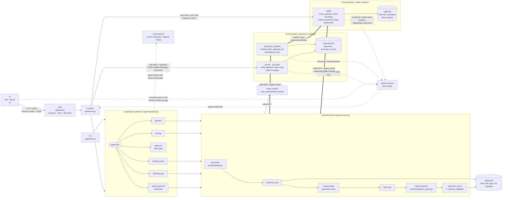
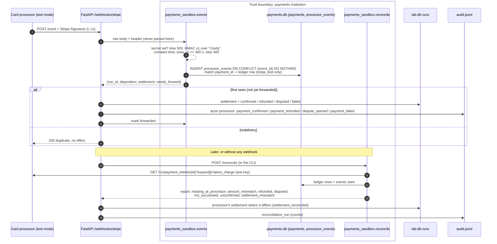

# Architecture

A deterministic LangGraph state machine books simulated train trips for the fictional operator
**Demo Rail**. The LLM only fills typed structures. Code runs every tool call, does the routing
and the selection, and takes the payment, behind one policy gate. Three institutions take part,
each behind its own trust boundary and with its own SQLite file:

| Institution | Code | Holds | Who may call it |
|---|---|---|---|
| **Agents / merchant** (the agent platform selling Demo Rail trips) | `agents/`, `api/` | checkpoints, run history (`lab.db`), the audit log | the signed-in user, through the API |
| **Wallet** (the agent platform's wallet) | `mcp_servers/wallet/` | card references (processor ids, brand, last four, expiry), mandates, single-use payment tokens as hashes (`wallet.db`) | the booking agent through the gate (`issue_payment_token`, approval-gated); the payments institution with its own identity (`redeem_payment_token`); the user's card and limit through the API |
| **Payments / processor** (the merchant's payment service provider in front of the card processor, test mode) | `mcp_servers/payments_sandbox/` | the ledger and processor events (`payments.db`) | the booking agent through the gate; signed processor webhooks via the API route |

The card number belongs to none of them: the customer types it on the processor's hosted page
and the processor vaults it.

## Components



Each node returns a partial state update and hands control back to `supervisor`. The supervisor
picks the next node from state alone: no candidates means `planner`, no quote (or offer) means
`pricing`, no approval means `approval`, approved with no holds means `booking_hold`, approved
with holds and no payment means `booking_pay`, and an open hosted checkout with no payment means
`await_payment`; a rejected decision ends the run. Seats are only
ever held after a human approved a selection. A terminal status (`needs_clarification`, `rejected`, `refused`, `failed`,
`completed`) ends the run. Any unexpected exception in a node (MCP transport, LLM endpoint,
token issuer) is audited as `node_error` (node and error type only) and ends the run as
`failed`, so no run is left `running` with no way forward. Recording `node_error` is best
effort: if the audit log itself refuses the write, the run still ends `failed` and carries the
flag `audit_failed:node_error`. If the audit write after a successful tool call fails, the gate
raises `UnauditedToolResult` with the result; for `payments.charge` the run still ends
`completed` with the payment and the flag `audit_failed:payments.charge`
(`tests/test_graph.py::test_audit_failure_after_charge_still_ends_completed_with_payment`).

## Approval, interrupt and resume

```mermaid
sequenceDiagram
    autonumber
    actor U as Human
    participant UI
    participant API as FastAPI
    participant G as Graph (SQLite checkpoints)
    participant GC as GatedToolClient
    participant TS as travel_search
    participant PAY as payments

    U->>UI: "Zurich to Bern on 1 December, back next day"
    UI->>API: POST /runs {message}
    API->>G: ainvoke(initial_state, thread_id=run_id)
    G->>GC: search_trains x2, get_fares x4 per leg (trains in the time window)
    GC->>TS: MCP calls (policy-checked, audited, guarded)
    G-->>G: approval node: interrupt({quote, quote_hash, offer, approve_before})
    G-->>API: state + __interrupt__
    API-->>UI: {status: awaiting_approval, quote, interrupt}
    UI->>U: Approval card (per-leg alternatives, window, CHF total, hash, deadline)
    U->>UI: picks another train on a leg
    UI->>API: POST /runs/{id}/quote {fare_ids}
    API-->>UI: Quote for that selection (total, quote_hash); no side effects
    U->>UI: Approve
    UI->>API: POST /runs/{id}/approval {approved, approver, quote_hash, fare_ids}
    Note over API: per-run lock; second click gets 409
    API->>G: Command(resume=decision)
    Note over G: approval node re-runs from the start,<br/>it has no side effects before interrupt()
    G-->>G: recompute the quote for fare_ids from the offer;<br/>hash must equal the approved hash (else rejected, quote_mismatch)
    G-->>G: issue signed approval token (run_id, quote_hash, amount, currency)
    G->>GC: hold_seat per passenger per leg (the chosen fares)
    GC->>TS: holds must sum to the approved total
    G->>GC: payments.charge(amount=quote.total_cents,<br/>idempotency_key=run_id) + approval token
    Note over GC: agent = booking (bound by the graph);<br/>token must match run, amount and approval_ref
    GC->>PAY: + agent_token issued for (booking, payments)
    PAY-->>GC: {payment_id, status: captured}
    API-->>UI: {status: completed, payment}
    UI->>API: GET /audit, GET /audit/verify
```

## Hosted Checkout: the customer pays, the processor decides

With `PAYMENTS_PROVIDER=stripe_test` the approver picks the payment model per run
(`payment_model`, signed into the approval token; `PAYMENTS_FLOW` = `both`, `checkout` or
`wallet` says which may be picked). The hosted Checkout (`agents/booking.py`) never confirms a
payment for the customer. `booking_pay` calls
`payments.create_checkout` (booking agent only, approval-gated, same signed approval token and
amount, currency and quote-hash binding as `payments.charge`); the payments server creates a
Checkout Session for exactly the approved total and records it as `checkout_pending` under the
run's ledger key. The run then pauses a second time, in `await_payment`, whose only action
before `interrupt()` is building the payload (session id, page URL, expiry, cents), so
re-running it on resume is side-effect free, exactly like `approval`.

```mermaid
sequenceDiagram
    autonumber
    actor C as Customer
    participant UI
    participant API as FastAPI
    participant G as Graph
    participant PAY as payments (ledger)
    participant PROC as Card processor (test)

    UI->>API: POST /runs/{id}/approval (session cookie)
    Note over API: approver := signed-in user
    API->>G: Command(resume=decision)
    G->>PAY: payments.create_checkout(total, quote_hash) + approval token
    PAY->>PROC: POST /v1/checkout/sessions (one line item = total, run id, idempotency key)
    PAY-->>G: checkout_pending {session_id, checkout_url}
    G-->>G: await_payment: interrupt({checkout_url, ...})
    API-->>UI: {status: awaiting_payment, checkout}
    C->>PROC: Pay with Stripe (hosted page, 3-D Secure if asked)
    PROC-->>UI: redirect PUBLIC_APP_URL/?run=id&checkout=success (proves nothing)
    alt signed webhook
        PROC->>API: checkout.session.completed (signed)
    else on demand (no webhook forwarder)
        UI->>API: POST /runs/{id}/payment/refresh
        API->>PROC: GET /v1/checkout/sessions/{id}
    end
    Note over API: run lock; session = the run's? paid? amount == approved?
    API->>PAY: transition checkout_pending -> captured (conditional UPDATE, one winner)
    API->>G: Command(resume={source})
    G->>PAY: payments.checkout_status (read-only, through the gate)
    PAY-->>G: captured {payment_id, receipt_url}
    API-->>UI: {status: completed, payment, settlement: confirmed}
```

The resume value only says which path woke the run; the outcome is the ledger, read through the
gate. Another amount or currency moves the ledger to `amount_mismatch` and the run to `refused`
(flag `amount_mismatch`); `checkout.session.expired` or `POST /runs/{id}/payment/cancel` (which
closes the session at the processor) move it to `checkout_expired`/`checkout_canceled` and the
run to `failed`. A still-open session leaves the run waiting (a spurious resume goes back to
`await_payment`). The API's `RunView.interrupt` only ever carries the approval pause; the payment
pause is `RunView.checkout`, so an approval body can never answer it (409).

## The wallet: the agent pays with a scoped single-use token

The second model. The customer saved a card once, on the processor's hosted form
(`mode=setup`); the wallet keeps the Customer and PaymentMethod ids, brand, last four digits and
expiry, and a mandate (limit per booking, integer cents). After the human approved the quote
*and chose the wallet*, `booking_pay` asks the wallet for a token, and the payments institution
redeems it before it charges.

```mermaid
sequenceDiagram
    autonumber
    participant G as Graph (booking_pay)
    participant GC as Gate
    participant W as wallet
    participant PAY as payments (ledger)
    participant PROC as Card processor (test)

    G->>GC: wallet.issue_payment_token(payer, total, CHF, run, merchant) + approval token
    Note over GC: policy: booking only, approval required;<br/>token claims: run, amount, quote hash, payment_model=wallet, payer
    GC->>W: issue (booking identity)
    W-->>G: {issued, payment_token, token_id, expires_at} or {issued: false, reason}
    G->>GC: payments.charge(total, run, payment_token, quote_hash) + approval token
    GC->>PAY: charge (booking identity)
    PAY->>W: redeem_payment_token(token, amount, CHF, merchant, run) (payments identity)
    W-->>PAY: {customer_id, payment_method_id} (once; replay, mismatch, expiry refused)
    PAY->>PROC: POST /v1/payment_intents off_session, confirm, customer, payment_method,<br/>Idempotency-Key run id, metadata run/quote hash/approval ref
    alt succeeded
        PROC-->>PAY: succeeded (+ latest_charge receipt)
        PAY-->>G: captured
    else authentication_required / requires_action / declined
        PROC-->>PAY: 402 or requires_action (nothing stored)
        PAY-->>G: {status: authentication_required}
        G->>GC: payments.create_checkout(same total) -> awaiting_payment
    end
```

- **The token never sits in state.** It lives in `booking_pay` for two calls; the audit log
  redacts it (`controls.redaction.SECRET_KEYS`), the checkpoints never see it, the model never
  does. The wallet stores only its SHA-256.
- **Fallbacks are explicit.** No saved card, an expired card, a total above the mandate, an
  authentication request or a decline open the hosted Checkout for the same amount; the run
  records `payment_fallback` and the audit `wallet_fallback` (reason only). A token refused at
  redemption (replay, other amount, merchant or run, expiry) refuses the run: that is misuse,
  not a reason to try another way.
- **Wallet events in the audit:** `wallet_token_issued`, `wallet_token_redeemed`,
  `wallet_fallback` (run entries, actor `wallet`); `wallet_setup_started`, `wallet_card_saved`
  (source `return` or `webhook`), `wallet_card_removed`, `wallet_mandate_changed` (run id
  `wallet`, with the user). None carries card data.

## Authentication

`api/auth.py`: demo users from `DEMO_USERS` (scrypt hashes, roles), a stateless session cookie
signed with `SESSION_SECRET` (`HttpOnly`, `SameSite=Strict`, `Secure` behind HTTPS, 8 h), and
in-memory token-bucket rate limits. Every route is on a router whose dependency requires a valid
session and, for `POST`, an allowed `Origin`; only `/health`, `/auth/login`, `/auth/logout` and
the signature-authenticated `/webhooks/stripe` are outside it. The approval endpoints replace
the body's `approver` with the signed-in user before the decision reaches the graph, so the
approval token, the `approval_ref` sent to the payments server and the audit all name them. The
requester is stored in the graph state and the `runs` table; `REQUIRE_SEPARATE_APPROVER=1`
compares the two. `create_app` raises when the configuration is missing, unless
`API_AUTH_DISABLED=1`.

## After the payment: processor events and reconciliation

The capture's synchronous answer is provisional. Afterwards the card processor (test mode) is
the source of truth: it reports refunds, disputes and late failures as signed events, and its
own record can be read back at any time.



- **Where events live, and why.** The events are facts about money, so they belong to the
  payments institution: `processor_events` sits in `PAYMENTS_DB_PATH`, next to the ledger it
  is matched against, written only by `mcp_servers/payments_sandbox/events.py`, which also
  holds the endpoint secret. The API only hosts the HTTP route (the institution has no HTTP
  server of its own in the lab): it forwards the raw body and signature header, never parses
  an unverified body, and receives a minimal verified notice (run id, payment id, settlement,
  integer cents). The agent side keeps a *copy* of the outcome (`runs.settlement`) and the
  evidence (the audit entry), not the event. The mapping payment id -> run id comes from the
  ledger (`idempotency_key` = run id), not from the agents' own `runs.payment_id`.
- **Idempotent, at least once.** The event id is the PRIMARY KEY; a redelivery is answered from
  the stored row (`200`, `duplicate`). A row is marked `forwarded_at` only after the run
  history and the audit entry are written, so if the API fails in between, the `500` makes the
  processor redeliver and the effect is applied then (never lost, at worst audited twice).
- **Order-independent settlement.** A run's settlement is derived from all events stored for
  its payment, strongest first: `disputed` > `refunded` > `confirmed` > `failed` (a success
  after a failed attempt is a retry that worked). A run that is captured gets `pending`, or what
  events that beat the graph already say; a later write of the run never overwrites a
  processor-reported settlement (`COALESCE`).
- **Only test mode, only processor captures.** A `livemode: true` event is stored as
  `livemode_rejected` and never applied. Only `stripe_test` ledger rows can be matched: a
  simulated capture never reached a processor, so an event naming it is `unmatched`.
- **Reconciliation corrects in both directions.** It needs only the test key (PaymentIntents
  read). A refund made in the dashboard with no webhook delivered becomes `refunded`; a signed
  but untrue event (e.g. the synthetic demo event) is reported as `settlement_mismatch` and the
  run is set back to what the processor's record shows.

## Persistence

| Store | File | Written by | Contents |
|---|---|---|---|
| Checkpoints | `LAB_DB_PATH` (default `var/lab.db`), tables `checkpoints`, `writes` | LangGraph `AsyncSqliteSaver`, opened and closed in the API lifespan | Every super-step of every run (`thread_id = run_id`), so a run paused at `interrupt()` survives a restart |
| Run history | same file, table `runs` | API layer (`agents/persistence.py: RunStore`), on start, pause and finish | `run_id`, `created_at`, `updated_at`, `request_redacted` (after `controls.redaction.redact`), `status`, `total_cents` (INTEGER), `currency`, `payment_id`, `flags` (JSON), `settlement` (copy of the processor's outcome; added in place to older files) |
| Payments ledger | `PAYMENTS_DB_PATH` (default `var/payments.db`), table `payments` | payments server only | `idempotency_key` PRIMARY KEY, `payment_id` UNIQUE, `provider`, `status`, `amount_cents` INTEGER > 0, `currency`, `hold_id`, `approval_ref`, `created_at` |
| Wallet | `WALLET_DB_PATH` (default `var/wallet.db`), tables `customers`, `cards`, `setup_sessions`, `mandates`, `payment_tokens` | wallet module (`mcp_servers/wallet/vault.py`), from the wallet server and the API's wallet routes | card references only (`customer_id`, `payment_method_id`, `brand`, `last4`, `exp_month`, `exp_year`); `limit_cents` INTEGER; tokens as `token_hash` (SHA-256) with their bounds (`amount_cents`, `currency`, `merchant_id`, `run_id`, `expires_at`) and `redeemed_at` (set once by a conditional UPDATE) |
| Processor events | same file, table `processor_events` | payments module (`events.py`), called by the webhook route | `event_id` PRIMARY KEY, `type`, `payment_id`, `amount_cents` INTEGER, `currency`, `livemode`, `created`, `received_at`, `disposition` (`matched` / `unmatched` / `livemode_rejected`), `idempotency_key` (the matched run), `forwarded_at` |

- **Restricted deserialization is store-independent.** `agents.graph.checkpoint_serde()` is a
  `JsonPlusSerializer(allowed_msgpack_modules=STATE_TYPES)`; both the in-memory saver (CLI,
  graph tests) and the SQLite saver are built with it. A checkpoint row holding any other type
  is not constructed as that type: LangGraph returns its raw data
  (`tests/test_persistence.py::test_persistent_checkpoints_keep_the_restricted_deserialisation`).
- **Resume after restart.** The approval endpoints look the run up in the checkpoints (404 if
  unknown) and create its lock on demand, so a run paused before a restart resumes normally;
  the approval token is issued after the decision, and the agent tokens are signed per call, so
  only the same `AGENT_TOKEN_SECRET` is needed. The offer's `expires_at` (15 minutes) still
  applies (`tests/test_persistence.py::test_paused_run_is_approved_after_an_api_restart`).
- **One capture per key, across processes.** The payments server looks the key up, calls the
  processor in `stripe_test` mode (with the same idempotency key, so the processor also
  captures once), and only then inserts with `ON CONFLICT (idempotency_key) DO NOTHING` inside
  `BEGIN IMMEDIATE`, returning the stored row. A concurrent second writer gets the first row;
  a failed processor call records nothing (`tests/test_payments_ledger.py`).
- **Postgres later.** Only `agents/persistence.py` (checkpointer factory and `RunStore`) and
  the payments `Ledger` class know about SQLite. `AsyncPostgresSaver` takes the same `serde=`.
- **Tests stay hermetic.** `tests/conftest.py` and `evals/conftest.py` point both variables at
  a temporary directory; tests that need their own file pass `tmp_path`.

## Decisions

### ADR-1: LLM proposes, code disposes

- **Context:** LLM output is non-deterministic and can be steered by anything it reads.
- **Decision:** The LLM only returns Pydantic-validated `Intent` (trip extraction) and
  `Rationale` (display text) through `LLM.extract`. The intent may carry a departure-time window
  per leg (`outbound_window`, `return_window`); its bounds are validated in code. Code does the
  routing, the pricing (every train in the window per leg, earliest first and capped at 12, default
  earliest 07:00, each train's cheapest 2nd-class fare, saver or standard), the recommendation
  (cheapest per leg, ties to the shortest journey, then the earliest), totals and payment.
- **Consequences:** Trajectories are deterministic for a given intent, so tests can assert
  exact tool sequences. A bad extraction (return before departure, unknown station, empty
  message, non-trip request) ends in `needs_clarification` with zero tool calls. What we give up:
  the agent cannot improvise beyond the coded flow.

### ADR-2: One gated client for every tool call

- **Context:** Controls spread across agents get skipped.
- **Decision:** All MCP calls go through `GatedToolClient.call` in a fixed order: policy check,
  audit `tool_call`, token injection, MCP call, injection guard, audit `tool_result`. Agents
  never see or pass the payments token. The gate drops any `agent_token` the caller supplies.
- **Consequences:** One place to review and test. A denied call is audited as `policy_denied`
  and never reaches the server. The cost: a node that imported an MCP client directly would
  bypass the gate. Code review and the tests are the only things that stop that.

### ADR-3: Approval is a side-effect-free node

- **Context:** On resume, LangGraph re-executes the interrupted node from its first line.
- **Decision:** `approval` does nothing before `interrupt()` except build the payload (the
  recommended quote and its hash, the offer with every per-leg alternative and the window used,
  and the offer's `approve_before`). Seat holds happen later in `booking_hold`, for the chosen
  fares only, and the charge after them in `booking_pay`. The decision names one offered fare
  per leg (`fare_ids`, omitted means the recommended one) and carries the hash of the quote the
  human saw (`POST /runs/{id}/quote` returns it). The node recomputes that quote from the offer
  alone: a fare outside the offer, not exactly one per leg, a different hash, or a recommended
  quote edited in state after display, rejects the run with the flag `quote_mismatch`
  (`tests/test_graph.py::test_selection_outside_the_offer_is_rejected_and_never_charged`,
  `::test_approval_node_recomputes_quote_hash`). `booking_hold` and `booking_pay` recompute the
  hash again before holding and charging
  (`tests/test_graph.py::test_booking_hold_refuses_a_quote_the_human_did_not_approve`,
  `::test_booking_pay_recomputes_quote_hash`).
- **Consequences:** A rejected run never holds a seat. Double approval is absorbed three times
  over: the API's per-run lock (409), the graph routing (holds and payment already set), and the
  payments `idempotency_key = run_id`.

### ADR-4: Scoped tokens across institutions

- **Context:** Payments belong to a different institution, and that institution should not
  trust the agent platform's claims.
- **Decision:** For each `payments.*` and `wallet.*` call the gate issues a short-lived HMAC
  token bound to `(agent, server, exp)` (`controls/identity.py`, TTL 300 s). The payments server
  accepts only `agent == "booking"` for `server == "payments"`; the wallet accepts `booking` for
  `issue_payment_token` and only the payments institution's own identity (`payments`, for
  server `wallet`) for `redeem_payment_token`. Payments also requires a non-empty
  `approval_ref` and enforces `idempotency_key`.
- **Consequences:** A pricing-agent token or an expired one is refused at the server, even if
  the policy gate were bypassed. Limits: the key is a shared symmetric secret, and the token is
  not single-use (see the threat model).

### ADR-5: Mock LLM in CI, live eval marker for the real model

- **Context:** CI must not depend on a GPU, a LAN endpoint or API keys. Real models still drift.
- **Decision:** `MockLLM` returns fixtures per schema. `evals/scenarios.jsonl` drives the full
  graph with in-memory MCP servers and asserts status, the exact tool trajectory, forbidden
  tools and amounts, never free text. `pytest -m live` reruns the same rows against the
  configured model (`provider` in `config/llm.yaml`, or `LLM_PROVIDER` / `LIVE_LLM_PROVIDER` when
  set; a `mock` YAML falls back to `vllm`) and prints a pass-rate. A row is skipped unless that
  provider is reachable: `VLLM_BASE_URL` for vllm, `ANTHROPIC_API_KEY` or `OPENAI_API_KEY`
  for the cloud providers (`tests/test_live_opt_in.py`).
- **Consequences:** CI tests the control logic deterministically. Model quality is a separate,
  measured number, not a hidden flake.

### ADR-6: The customer confirms the payment on the processor's page

- **Context:** an agent that confirms a card payment with a stored card on the customer's behalf
  is a merchant-initiated payment: under strong customer authentication rules it needs a prior
  mandate, and the customer never authenticates the amount the human approved.
- **Decision:** with the test-mode processor, the default flow opens a hosted Checkout Session
  for exactly the approved total and pauses the run (`await_payment`). Completion comes only
  from the processor's record (signed webhook, or the session read back on demand), applied by
  a conditional ledger update under the run's lock, then read by the resumed graph through the
  gate. The merchant-initiated alternative is the wallet (ADR-7), not a stored test card.
- **Consequences:** a second pause and two more tools (`payments.create_checkout`,
  approval-gated; `payments.checkout_status`, read-only). The Checkout page lives at least 30
  minutes, longer than the 15-minute seat holds: a late payment is flagged
  `paid_after_hold_expiry` instead of being refused (the money already moved).

### ADR-7: The agent pays from a wallet with a scoped, single-use token

- **Context:** some purchases should finish without the customer on a payment page (a repeat
  booking the customer delegated). Agent platforms do this by vaulting the card themselves and
  handing the merchant a scoped credential, not the card; the old fixed test card showed the
  charge but none of those controls.
- **Decision:** a third institution, the wallet (`mcp_servers/wallet/`, its own `wallet.db`).
  The card is saved on the processor's hosted form (`mode=setup`); the wallet keeps references
  only and a mandate per user. The human picks the wallet per run; the choice and the payer are
  signed into the approval token, and the gate issues `wallet.issue_payment_token` only with
  that token. The token is single use, bound to the exact amount, currency, merchant, run and 15
  minutes; the payments institution redeems it at the wallet with its own identity and charges
  off-session with the run id as idempotency key. SCA, over-limit, no card or a decline fall
  back to the hosted Checkout.
- **Consequences:** a third MCP server and a service-to-service call (payments to wallet). The
  lab's wallet and payments share one processor account, so the wallet can hand over processor
  ids; a real scheme would issue a network or shared payment token instead (next step).

## Runtime layout

| Process | How it runs |
|---|---|
| API | `uvicorn api.server:app` (or the `api` container); opens `var/lab.db` in its lifespan |
| travel_search, payments, wallet | stdio subprocesses of the API/CLI process (`python -m mcp_servers.<name>.server`), kept alive between calls. If one dies (also mid-call, when the session reports `Connection closed`), the gate audits `transport_reset` and starts a fresh subprocess; a server that stalls past the per-request deadline (`MCP_CALL_TIMEOUT_S`, default 10 s) is handled the same way. Only read-only tools (`search_trains`, `get_fares`) are retried in the same call (`tests/test_mcp_reconnect.py`) |
| wallet (for payments) | the payments server starts its own stdio wallet subprocess per redemption (`keep_alive=False`), over the same `wallet.db` |
| Tests and evals | everything in-process: `fastmcp.Client(mcp)` in memory (payments reaches the wallet in memory too) |
| Model | vLLM on DGX Spark on the LAN (`VLLM_BASE_URL`), or Anthropic/OpenAI, or mock |
